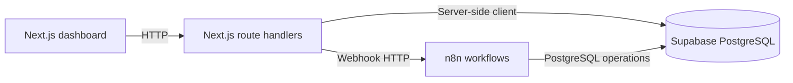

# Fiscalization Simulator

A local transaction-security and payment-compliance case study that demonstrates receipt lifecycle management, deterministic mock signing, receipt verification, hash-chain integrity checks, audit events, and operational error monitoring.

> **Educational simulator:** This project does not implement certified Austrian RKSV fiscalization, real asymmetric signatures, FinanzOnline integration, or production key management. It is intended to demonstrate fiscalization concepts in a controlled local environment.

## Project overview

The Fiscalization Simulator models an organization, signing unit, cash register, and receipt workflow. The Next.js dashboard initiates operations through server-side API routes, n8n executes the application workflows, and Supabase PostgreSQL provides the persistent domain model.

### Key capabilities

- Organization, mock signing-unit, and cash-register management
- POS receipt submission with sequential register numbering
- Deterministic mock receipt signing with SHA-256 hashes
- Receipt verification and register-level integrity checks
- Append-style audit event inspection
- Receipt JSON export
- Workflow validation and application-error monitoring
- Server-side Next.js proxy routes for n8n

## Architecture



| Component | Responsibility |
|---|---|
| Next.js 16 | Dashboard UI and server-side API proxy |
| n8n | HTTP API, request validation, workflow orchestration |
| Supabase PostgreSQL | Persistent entities, sequences, signing functions, and audit records |

Detailed design references are available in [docs/](docs/).

## Repository structure

```text
frontend/
  src/
    app/          Pages and Next.js API route handlers
    components/   Layout and reusable UI components
    lib/          API and server-side integration clients
    types/        Shared TypeScript domain types
docs/
  api.md
  database-schema.md
  n8n-workflows.md

```

## Technology

- Next.js 16 with the App Router
- React 19
- TypeScript 5
- Tailwind CSS 4
- Supabase PostgreSQL and `@supabase/supabase-js`
- n8n webhooks
- ESLint 9

## Local setup

### Prerequisites

- Node.js 20 or newer
- npm
- n8n accessible at a local webhook base URL
- Supabase project with the required schema and functions

### Install

```bash
cd frontend
npm install
```

### Configure environment variables

Copy the safe example file when creating a new local environment:

```bash
cp .env.example .env.local
```

On Windows PowerShell:

```powershell
Copy-Item .env.example .env.local
```

Configure the placeholders in `.env.local` as documented by [frontend/.env.example](frontend/.env.example). Existing local credentials must remain managed in `.env.local`; the repository ignores environment-specific secret files.

Required variables:

| Variable | Purpose |
|---|---|
| `N8N_API_BASE_URL` | Static n8n webhook base URL |
| `N8N_WF07_RECEIPT_URL` | Parameterized receipt retrieval webhook |
| `N8N_WF07_REGISTER_RECEIPTS_URL` | Parameterized register receipt webhook |
| `N8N_WF08_AUDIT_LIST_URL` | Organization audit event webhook |
| `N8N_WF08_AUDIT_EVENT_URL` | Parameterized audit event webhook |
| `SUPABASE_URL` | Supabase project URL |
| `SUPABASE_SERVICE_ROLE_KEY` | Server-only Supabase service-role key |

> The Supabase service-role key must never be referenced by browser components or `NEXT_PUBLIC_*` variables.

### Run

```bash
cd frontend
npm run dev
```

Open `http://localhost:3000`.

## Quality checks

```bash
cd frontend
npm run lint
npx tsc --noEmit
npm run build
```

The project currently has no dedicated test runner or test suite. Quality checks are limited to linting, TypeScript validation, and a production build.

## Core workflow

1. Create an organization.
2. Create a MOCK signing unit for the organization.
3. Create an active cash register associated with that signing unit.
4. Submit a receipt.
5. Sign the receipt.
6. Verify the receipt hash, mock signature, and hash chain.
7. Inspect audit events or run a register integrity check.

## Security and publication

- Never commit `.env`, `.env.local`, or other environment-specific secret files.
- Keep the Supabase service-role key in server-side environment variables only.
- Supabase credentials are consumed by Next.js server route handlers, not by browser code.
- Existing credentials and webhook node identifiers must be rotated if they are ever exposed outside the local environment.
- This repository is intentionally not licensed for reuse until a license is chosen.
