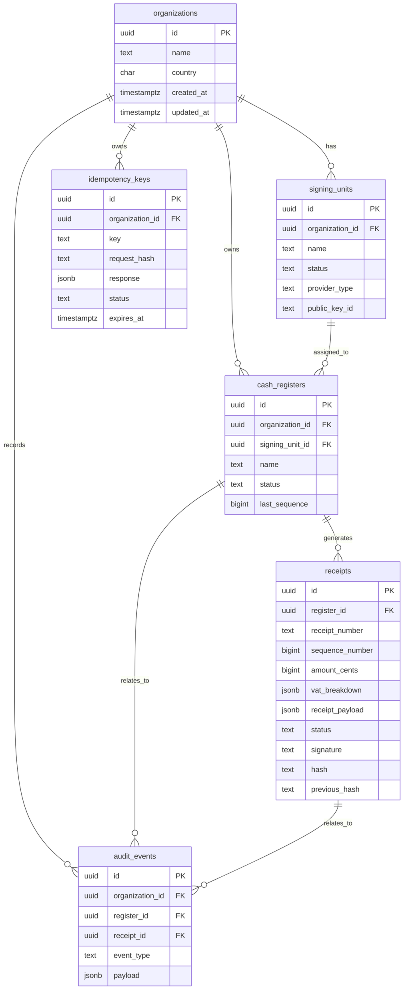

# Database Schema

## Overview

The database is designed to support a fiscalization workflow, covering organizations, signing units, cash registers, receipts, and audit events.

It uses PostgreSQL with UUID-based primary keys, JSONB fields for structured payloads, and relational constraints to maintain data integrity.

## Database Structure

The schema consists of six core tables:

| Table | Purpose |
|---|---|
| `organizations` | Stores registered organizations and their country |
| `signing_units` | Represents signing units belonging to an organization |
| `cash_registers` | Manages cash registers and their signing-unit associations |
| `receipts` | Stores receipt data, sequence numbers, signatures and hashes |
| `audit_events` | Records relevant events for traceability |
| `idempotency_keys` | Prevents duplicate processing of requests |

## Entity Relationship Diagram



## SQL Definition

The following section contains the complete PostgreSQL schema.

### 1. Organizations

Stores the organizations registered in the system. Each organization is associated with a supported country.

```sql
CREATE TABLE public.organizations (
    id uuid NOT NULL DEFAULT gen_random_uuid(),
    name text NOT NULL,
    country character NOT NULL
        CHECK (country = ANY (ARRAY['AT'::bpchar, 'DE'::bpchar])),
    created_at timestamp with time zone NOT NULL DEFAULT now(),
    updated_at timestamp with time zone NOT NULL DEFAULT now(),

    CONSTRAINT organizations_pkey PRIMARY KEY (id)
);
```

### 2. Signing Units

Represents the signing units associated with an organization, including their current status and provider type.

```sql
CREATE TABLE public.signing_units (
    id uuid NOT NULL DEFAULT gen_random_uuid(),
    organization_id uuid NOT NULL,
    name text NOT NULL,
    status text NOT NULL DEFAULT 'INITIALIZED'::text
        CHECK (status = ANY (
            ARRAY['INITIALIZED', 'ACTIVE', 'SUSPENDED', 'DISABLED']::text[]
        )),
    provider_type text NOT NULL DEFAULT 'MOCK'::text
        CHECK (provider_type = ANY (
            ARRAY['MOCK', 'EXTERNAL']::text[]
        )),
    public_key_id text,
    created_at timestamp with time zone NOT NULL DEFAULT now(),
    updated_at timestamp with time zone NOT NULL DEFAULT now(),

    CONSTRAINT signing_units_pkey PRIMARY KEY (id),
    CONSTRAINT signing_units_organization_id_fkey
        FOREIGN KEY (organization_id)
        REFERENCES public.organizations(id)
);
```

### 3. Cash Registers

Stores cash registers, their organization and signing-unit association, and the current receipt sequence number.

```sql
CREATE TABLE public.cash_registers (
    id uuid NOT NULL DEFAULT gen_random_uuid(),
    organization_id uuid NOT NULL,
    signing_unit_id uuid,
    name text NOT NULL,
    status text NOT NULL DEFAULT 'CREATED'::text
        CHECK (status = ANY (
            ARRAY['CREATED', 'ACTIVE', 'SUSPENDED', 'DISABLED']::text[]
        )),
    last_sequence bigint NOT NULL DEFAULT 0
        CHECK (last_sequence >= 0),
    created_at timestamp with time zone NOT NULL DEFAULT now(),
    updated_at timestamp with time zone NOT NULL DEFAULT now(),

    CONSTRAINT cash_registers_pkey PRIMARY KEY (id),
    CONSTRAINT cash_registers_organization_id_fkey
        FOREIGN KEY (organization_id)
        REFERENCES public.organizations(id),
    CONSTRAINT cash_registers_signing_unit_id_organization_id_fkey
        FOREIGN KEY (signing_unit_id)
        REFERENCES public.signing_units(id)
);
```

### 4. Receipts

Stores receipt information, including amounts, VAT breakdowns, signatures, hashes and processing status.

```sql
CREATE TABLE public.receipts (
    id uuid NOT NULL DEFAULT gen_random_uuid(),
    register_id uuid NOT NULL,
    receipt_number text NOT NULL,
    sequence_number bigint NOT NULL
        CHECK (sequence_number > 0),
    amount_cents bigint NOT NULL
        CHECK (amount_cents >= 0),
    currency character NOT NULL DEFAULT 'EUR'::bpchar,
    vat_breakdown jsonb NOT NULL DEFAULT '[]'::jsonb
        CHECK (jsonb_typeof(vat_breakdown) = 'array'),
    receipt_payload jsonb NOT NULL
        CHECK (jsonb_typeof(receipt_payload) = 'object'),
    status text NOT NULL DEFAULT 'PENDING'::text
        CHECK (status = ANY (
            ARRAY['PENDING', 'PROCESSING', 'SIGNED', 'FAILED']::text[]
        )),
    signature text,
    hash text,
    previous_hash text,
    key_id text,
    created_at timestamp with time zone NOT NULL DEFAULT now(),
    signed_at timestamp with time zone,
    updated_at timestamp with time zone NOT NULL DEFAULT now(),

    CONSTRAINT receipts_pkey PRIMARY KEY (id),
    CONSTRAINT receipts_register_id_fkey
        FOREIGN KEY (register_id)
        REFERENCES public.cash_registers(id)
);
```

### 5. Audit Events

Records events associated with organizations, registers and receipts to provide traceability.

```sql
CREATE TABLE public.audit_events (
    id uuid NOT NULL DEFAULT gen_random_uuid(),
    organization_id uuid NOT NULL,
    register_id uuid,
    receipt_id uuid,
    event_type text NOT NULL,
    payload jsonb NOT NULL DEFAULT '{}'::jsonb
        CHECK (jsonb_typeof(payload) = 'object'),
    created_at timestamp with time zone NOT NULL DEFAULT now(),

    CONSTRAINT audit_events_pkey PRIMARY KEY (id),
    CONSTRAINT audit_events_organization_id_fkey
        FOREIGN KEY (organization_id)
        REFERENCES public.organizations(id),
    CONSTRAINT audit_events_register_id_fkey
        FOREIGN KEY (register_id)
        REFERENCES public.cash_registers(id),
    CONSTRAINT audit_events_receipt_id_fkey
        FOREIGN KEY (receipt_id)
        REFERENCES public.receipts(id)
);
```

### 6. Idempotency Keys

Tracks incoming requests to prevent duplicate processing and stores their associated request hashes and responses.

```sql
CREATE TABLE public.idempotency_keys (
    id uuid NOT NULL DEFAULT gen_random_uuid(),
    organization_id uuid NOT NULL,
    key text NOT NULL,
    request_hash text NOT NULL,
    response jsonb,
    status text NOT NULL DEFAULT 'PROCESSING'::text
        CHECK (status = ANY (
            ARRAY['PROCESSING', 'COMPLETED', 'FAILED']::text[]
        )),
    created_at timestamp with time zone NOT NULL DEFAULT now(),
    expires_at timestamp with time zone,

    CONSTRAINT idempotency_keys_pkey PRIMARY KEY (id),
    CONSTRAINT idempotency_keys_organization_id_fkey
        FOREIGN KEY (organization_id)
        REFERENCES public.organizations(id)
);
```

---

*This schema documents the database structure used by the local n8n fiscalization demonstration. It is provided for technical reference and learning purposes.*
